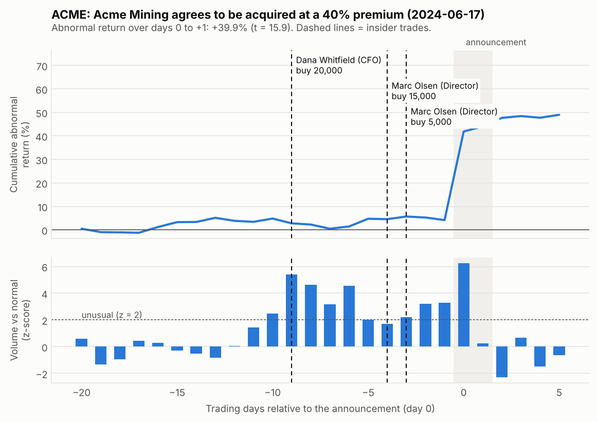
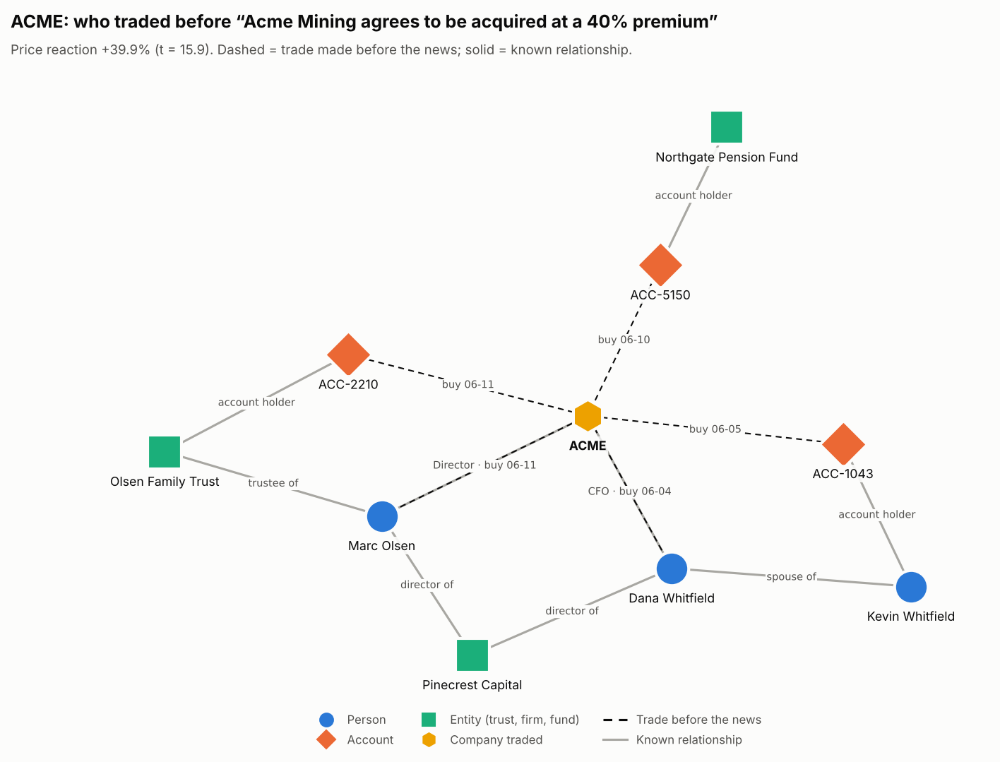

# MEMORANDUM

> **Demonstration document.** All companies, people, accounts and figures are fictional and come from the synthetic dataset in this repository. The memo shows how the toolkit's output would be reported to a case team.

**To:** Enforcement case team · **From:** Data Science · **Date:** November 24, 2026  
**Re:** Trading in Acme Mining (ACME) before the June 17, 2024 takeover announcement  
**Status:** Preliminary, for case-team review. Not a finding of wrongdoing.

## Bottom line

1. **ACME's share price rose about 40% on the takeover news, beyond what the overall market explains.** A move this large would almost never happen by chance (t = 15.9; see Exhibit 1).
2. **Five accounts linked to two ACME insiders bought shares in the 9 trading days before the announcement.** They are the CFO, a director, the CFO's spouse and the director's family trust. At the price the day after the news, these purchases were worth about **$627,000 more than they cost**.
3. **Timing, a late filing, trading through a spouse and a trust, and a shared outside board all point the same way.** We recommend opening an investigation into the CFO and the director.

## What happened

| Date (2024) | Event |
|---|---|
| June 4 | CFO **Dana Whitfield** buys 20,000 ACME shares at $16.04. Reported June 6. |
| June 5 | Her spouse, **Kevin Whitfield**, buys 30,000 ACME shares in his own account. |
| June 10 | **Northgate Pension Fund** buys 50,000 shares. No known link to an insider. |
| June 11 | Director **Marc Olsen** buys 15,000 shares. The **Olsen Family Trust**, of which he is trustee, buys 25,000. |
| June 12 | Marc Olsen buys another 5,000 shares. **Reported July 2**, 20 days later and after the announcement. |
| June 4–14 | Volume runs about three times normal, with no public news. |
| **June 17** | **Takeover announced at a 40% premium.** The stock closes at $22.13, up from $16.04. |

## Who traded, and how they are connected

| Trader | Connection to an ACME insider | Bought | Days before news | Value gained* |
|---|---|---|---|---|
| Dana Whitfield | is the CFO | 20,000 | 9 | $132,200 |
| Kevin Whitfield | spouse of the CFO *(source: account-opening KYC form)* | 30,000 | 8 | $197,400 |
| Marc Olsen | is a director | 15,000 + 5,000 | 4 and 3 | $131,600 |
| Olsen Family Trust | Marc Olsen is trustee *(source: trust registry)* | 25,000 | 4 | $166,000 |
| **Linked total** | | **95,000** | | **≈ $627,200** |
| Northgate Pension Fund | none known | 50,000 | 5 | $320,000 |

\* Shares × (closing price on June 18 − purchase price). An indication only, not a profit calculation for legal purposes.

Dana Whitfield and Marc Olsen are also both directors of **Pinecrest Capital** *(source: corporate registry)*. That gives them a channel for contact outside ACME itself (Exhibit 3).

## Why this stands out

- **Size of the news.** Adjusted for the market, ACME rose 39.9% over the announcement day and the next. On a normal day it moves about 1.8% more or less than the market predicts.
- **Timing.** Every linked purchase falls in the 9 trading days before the news. Neither insider traded ACME in the previous six months.
- **Activity before the news.** Volume ran well above normal for two weeks (z = 3.3) while the price barely moved, consistent with buyers who knew something the market didn't.
- **Reporting.** One of Marc Olsen's purchases was reported 20 days late (deadline: 5), after the news was public. The CFO's purchase was filed twice; we counted it once.
- **Trading through others.** The spouse's and the trust's purchases account for 58% of the linked gain.

## What this analysis does not show

- **It does not show that anyone had or used inside information**, only trading that needs explaining. Legitimate reasons, such as a pre-arranged trading plan, must be ruled out.
- **We don't yet know who knew about the deal, and when.** We assumed both insiders could have known.
- **"No known link" is not "no link".** Northgate made the largest single gain. It should be explained, not assumed innocent.
- **Gains are estimates** at one point in time, before costs.

## Recommended next steps

1. **Who knew, and when:** obtain the deal timeline and the list of people with access, from ACME and its advisers.
2. **Trading plans and pre-clearance records** for Dana Whitfield and Marc Olsen.
3. **Account records** for Kevin Whitfield and the Olsen Family Trust: who placed the orders, and where the money came from.
4. **Northgate Pension Fund:** the rationale and approval record for the June 10 purchase.
5. **Pinecrest Capital:** board meeting dates and attendance, late May to June 14.

## Secondary matter: Condor Tech (CNDR)

VP **Leo Tremblay** sold 8,000 shares 7 trading days before a guidance cut on October 24, 2024 (−15% beyond the market). His sister **Julie Tremblay** sold 12,000 shares 3 days before it *(source: interview notes)*. Together they avoided about **$28,800** in losses. Smaller, but the same pattern; we suggest the same first steps.

---

### Exhibit 1: ACME price and volume around the announcement

### Exhibit 2: Data and method

- **Data quality (Module 1).** Every source file was fingerprinted, and the files can be re-checked at any time with `validation.cli verify-custody`. Rows with errors were excluded from the analysis. None of them affect the ACME findings. Full list: `reports/data_quality/data_quality_report.md`.
- **Price analysis (Module 2).** Market model fitted on 108 trading days before the event, against the market index (beta 1.41). See `reports/detection/detection_report.md`.
- **Relationships (Module 3).** Shortest links between trading accounts and insiders, each with its source. See `reports/graph/network_report.md`.
- **Reproduce:** `python -m enforcement_toolkit.graph.cli --config config/graph.yaml`. Rules, thresholds and limitations are in `METHODOLOGY.md`.

### Exhibit 3: Who traded before the news, and how they connect

