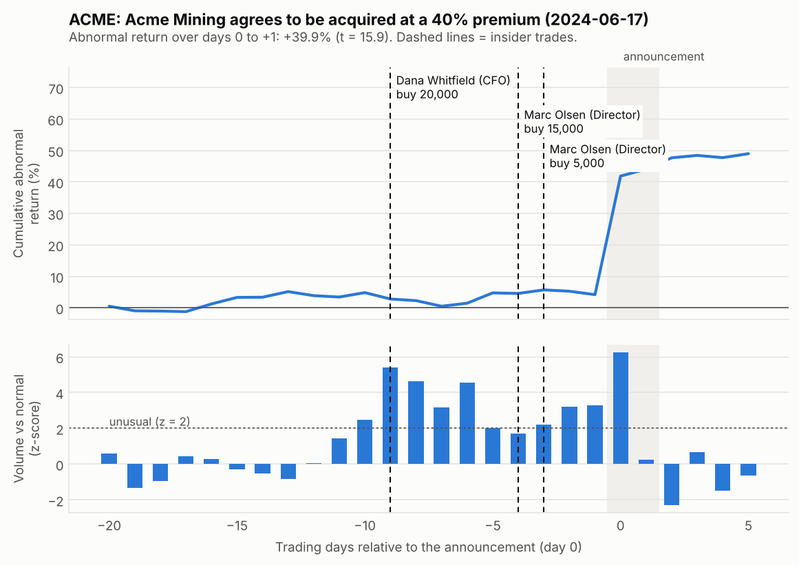
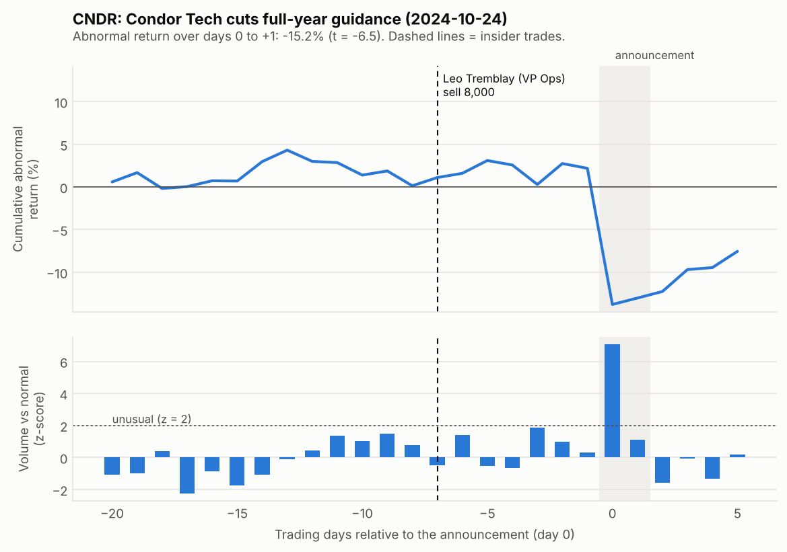

# Insider Trading Screen

Generated 2026-11-25T00:46:53+00:00 · 3 events studied, 2 material · 4 insider trades matched to events · **4 flagged (3 high priority)**

> **How to read this.** A trade is flagged when an insider traded shortly before material news **and** in the direction that would profit from it. Flags are leads for review, not findings of wrongdoing: insiders may have legitimate reasons (e.g. a pre-arranged trading plan), which only an investigation can establish.

## Events

How strongly each stock reacted to its news, after removing what the overall market did. `material` means |t| ≥ 2.0.

| event_id | ticker | event_date | event_type | status | beta | car_event_pct | t_event | material | car_pre_event_pct | t_pre_event | volume_z_pre_event | estimation_days |
|---|---|---|---|---|---|---|---|---|---|---|---|---|
| E004 | CNDR | 2024-01-10 | guidance | only 0 estimation days (need 60) |  |  |  | False |  |  |  | 0 |
| E001 | ACME | 2024-06-17 | m_and_a | ok | 1.41 | 39.88 | 15.93 | True | 0.76 | 0.14 | 3.26 | 108 |
| E003 | CNDR | 2024-10-24 | guidance | ok | 1.56 | -15.21 | -6.46 | True | -0.67 | -0.13 | 0.62 | 110 |

## Flagged trades (ranked)

| priority | score | trade_id | insider_name | insider_role | ticker | transaction_type | trade_date | trading_days_before | gain_or_loss_avoided | filed_after_news | event_id |
|---|---|---|---|---|---|---|---|---|---|---|---|
| High | 85 | T008 | Marc Olsen | Director | ACME | buy | 2024-06-12 | 3 | 32000 | True | E001 |
| High | 75 | T001 | Dana Whitfield | CFO | ACME | buy | 2024-06-04 | 9 | 132200 | False | E001 |
| High | 75 | T002 | Marc Olsen | Director | ACME | buy | 2024-06-11 | 4 | 99600 | False | E001 |
| Medium | 40 | T005 | Leo Tremblay | VP Ops | CNDR | sell | 2024-10-15 | 7 | 13120 | False | E003 |

## Details

### E001: Acme Mining agrees to be acquired at a 40% premium

**Marc Olsen** (Director) bought 5,000 ACME shares on 2024-06-12 at about $16.25, 3 trading days before *"Acme Mining agrees to be acquired at a 40% premium"* (2024-06-17). Adjusted for the market, the stock rose 39.9% on the news. Valued at the close on 2024-06-18 ($22.65), the estimated gain is **$32,000**. The trade was filed on 2024-07-02, after the news was public.

- **Score 85 (High)**, made up of:
  - +25 traded 3 trading day(s) before the news
  - +20 very large price reaction to the news (t = 15.9)
  - +10 gain / loss avoided about $32,000
  - +15 the trade was not reported until after the news was public
  - +5 filed 20 days after the trade (deadline 5)
  - +10 unusually high market volume before the news (z = 3.3)

**Dana Whitfield** (CFO) bought 20,000 ACME shares on 2024-06-04 at about $16.04, 9 trading days before *"Acme Mining agrees to be acquired at a 40% premium"* (2024-06-17). Adjusted for the market, the stock rose 39.9% on the news. Valued at the close on 2024-06-18 ($22.65), the estimated gain is **$132,200**. The trade was filed on 2024-06-06, before the news. The same trade was also filed as T010 (counted once).

- **Score 75 (High)**, made up of:
  - +15 traded 9 trading days before the news
  - +20 very large price reaction to the news (t = 15.9)
  - +20 gain / loss avoided about $132,200
  - +10 no other trades by this insider in this stock in the previous 180 days
  - +10 unusually high market volume before the news (z = 3.3)

**Marc Olsen** (Director) bought 15,000 ACME shares on 2024-06-11 at about $16.01, 4 trading days before *"Acme Mining agrees to be acquired at a 40% premium"* (2024-06-17). Adjusted for the market, the stock rose 39.9% on the news. Valued at the close on 2024-06-18 ($22.65), the estimated gain is **$99,600**. The trade was filed on 2024-06-13, before the news.

- **Score 75 (High)**, made up of:
  - +25 traded 4 trading day(s) before the news
  - +20 very large price reaction to the news (t = 15.9)
  - +10 gain / loss avoided about $99,600
  - +10 no other trades by this insider in this stock in the previous 180 days
  - +10 unusually high market volume before the news (z = 3.3)

### E003: Condor Tech cuts full-year guidance

**Leo Tremblay** (VP Ops) sold 8,000 CNDR shares on 2024-10-15 at about $8.15, 7 trading days before *"Condor Tech cuts full-year guidance"* (2024-10-24). Adjusted for the market, the stock fell 15.2% on the news. Valued at the close on 2024-10-25 ($6.51), the estimated loss avoided is **$13,120**. The trade was filed on 2024-10-17, before the news.

- **Score 40 (Medium)**, made up of:
  - +15 traded 7 trading days before the news
  - +20 very large price reaction to the news (t = -6.5)
  - +5 gain / loss avoided about $13,120

## Trades checked but not flagged

_none_

## Method and limits

- Market model fitted on trading days -120 to -11 before each event, against `MKT`. Days with returns above 50% (likely data errors) are left out of the fit.

- Trades are checked if made within 30 calendar days before the event. Grants and option exercises are excluded.

- Gains are estimated at the close on day +1. They ignore later price moves and costs, and are an indication, not a calculation of profit for legal purposes.

- Duplicate filings of the same trade are counted once. Rows quarantined by Module 1 are never used.

- The score weights are triage rules, set out in `METHODOLOGY.md`. They are not statistically estimated.
