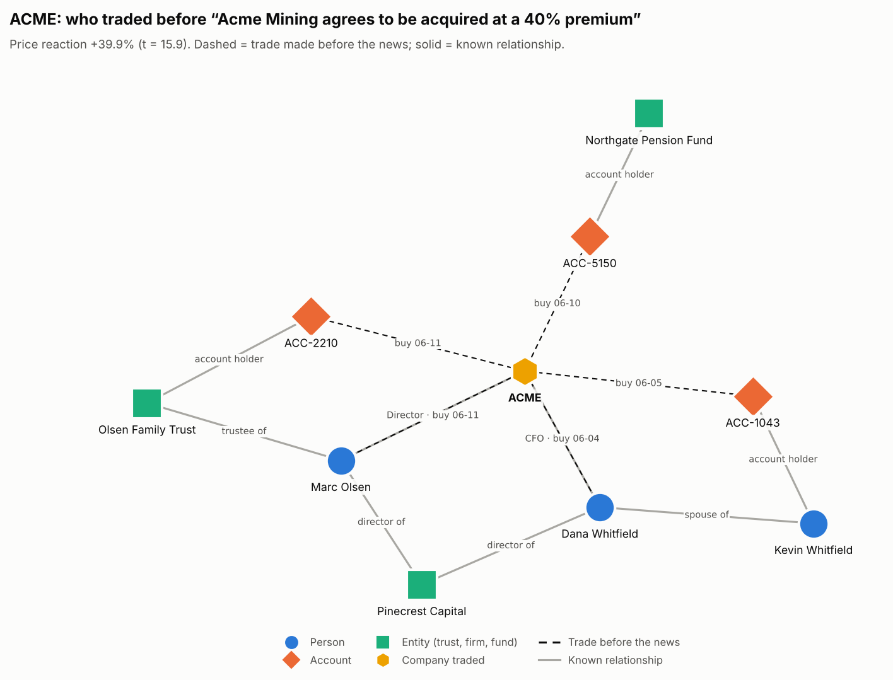
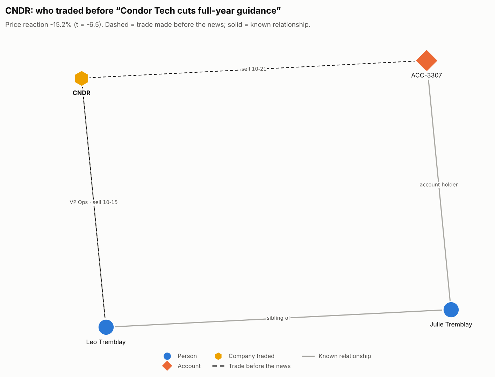

# Relationship Network Report

Generated 2026-11-25T00:46:54+00:00 · graph of 23 entities and 18 links · **3 account trade(s) before material news are linked to an insider of that company**

> **How to read this.** Module 2 only sees insiders who reported their own trades. This report adds account records and known relationships (family, trusts, shared directorships), then traces whether accounts that traded profitably before the news connect to an insider. A link is a reason to look closer, not proof that information passed along it. Every link lists where it came from. Read connections left to right: `A —[x]→ B` means A is x B (e.g. Kevin —[spouse of]→ Dana).

## E001: Acme Mining agrees to be acquired at a 40% premium (2024-06-17)

### Account trades before the news

| status | trade_id | account_id | account_holder | side | shares | trade_date | trading_days_before | gain_or_loss_avoided | connection | evidence |
|---|---|---|---|---|---|---|---|---|---|---|
| Linked to insider | A001 | ACC-1043 | Kevin Whitfield | buy | 30000 | 2024-06-05 | 8 | 197400 | ACC-1043 ←[account holder]— Kevin Whitfield —[spouse of]→ Dana Whitfield —[CFO]→ ACME | account records; account opening (KYC) form; insider filings |
| Linked to insider | A002 | ACC-2210 | Olsen Family Trust | buy | 25000 | 2024-06-11 | 4 | 166000 | ACC-2210 ←[account holder]— Olsen Family Trust ←[trustee of]— Marc Olsen —[Director]→ ACME | account records; trust registry; insider filings |
| No known link | A004 | ACC-5150 | Northgate Pension Fund | buy | 50000 | 2024-06-10 | 5 | 320000 |  |  |
| Traded against the news | A005 | ACC-6020 | Mei Chen | sell | 4000 | 2024-06-12 | 3 | -25600 |  |  |

- **Kevin Whitfield** (ACC-1043) bought 30,000 ACME shares 8 trading days before the news (≈ $197,400). Connection to insider **Dana Whitfield** in 2 link(s): ACC-1043 ←[account holder]— Kevin Whitfield —[spouse of]→ Dana Whitfield —[CFO]→ ACME. Sources: account records; account opening (KYC) form; insider filings.

- **Olsen Family Trust** (ACC-2210) bought 25,000 ACME shares 4 trading days before the news (≈ $166,000). Connection to insider **Marc Olsen** in 2 link(s): ACC-2210 ←[account holder]— Olsen Family Trust ←[trustee of]— Marc Olsen —[Director]→ ACME. Sources: account records; trust registry; insider filings.

### Links between flagged insiders (other than the company itself)

- Dana Whitfield —[director of]→ Pinecrest Capital ←[director of]— Marc Olsen (sources: corporate registry)

## E003: Condor Tech cuts full-year guidance (2024-10-24)

### Account trades before the news

| status | trade_id | account_id | account_holder | side | shares | trade_date | trading_days_before | gain_or_loss_avoided | connection | evidence |
|---|---|---|---|---|---|---|---|---|---|---|
| Linked to insider | A003 | ACC-3307 | Julie Tremblay | sell | 12000 | 2024-10-21 | 3 | 15720 | ACC-3307 ←[account holder]— Julie Tremblay —[sibling of]→ Leo Tremblay —[VP Ops]→ CNDR | account records; investigator interview notes; insider filings |

- **Julie Tremblay** (ACC-3307) sold 12,000 CNDR shares 3 trading days before the news (≈ $15,720). Connection to insider **Leo Tremblay** in 2 link(s): ACC-3307 ←[account holder]— Julie Tremblay —[sibling of]→ Leo Tremblay —[VP Ops]→ CNDR. Sources: account records; investigator interview notes; insider filings.

### Links between flagged insiders (other than the company itself)

_None found._

## Method and limits

- Paths are searched up to 4 links, excluding the company itself, so two people are never “connected” merely because both are linked to ACME.

- Account trades are checked if made within 30 calendar days before a material event (from Module 2), in the direction that would profit.

- The graph only knows the relationships it is given. “No known link” means none was found, not that none exists.

- Relationships without an `evidence_source` are rejected by Module 1 validation.

- Explore the full graph: open `graph.graphml` in Gephi or yEd.
